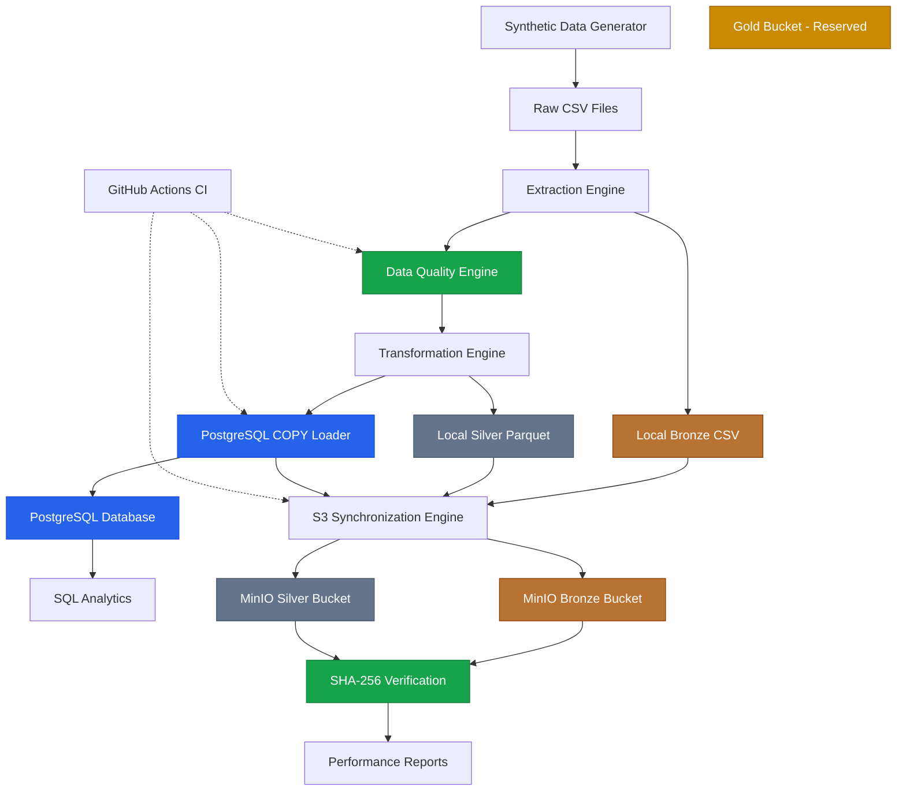

<!-- Profile README: Anuj05Chandrol/Anuj05Chandrol -->

  

  

  
  
  

  
  
  

## 👨‍💻 About Me

I am a **2026 B.Tech Data Science Engineering graduate** from LNCT Group of Colleges, Bhopal, India.

I build practical data engineering pipelines, analytical workflows and machine learning applications using Python, SQL and modern data infrastructure.

My current engineering focus includes:

- End-to-end batch ETL pipelines and data integration.
- S3-compatible object storage and data lake architecture.
- Data quality validation and financial reconciliation.
- PostgreSQL databases and columnar Parquet storage.
- Automated testing, CI/CD and reproducible engineering benchmarks.

I am expanding into distributed data processing, real-time streaming, MLOps and generative AI.

**Open to entry-level opportunities:** Data Engineer · Data Analyst · Python Developer · Software Engineer · Data Science / ML roles across India.

## ⚡ Engineering Highlights

*Measured local results from the DataFlow Nexus synthetic-data engineering platform.*

## 🚀 Featured Project — DataFlow Nexus

A modular end-to-end data engineering platform simulating an e-commerce data ecosystem, integrating synthetic data generation, validated batch ETL, PostgreSQL ingestion, columnar storage, S3-compatible data lakes and automated file integrity verification.

### System Architecture

### 📊 Batch ETL Benchmarks

| Metric | Local benchmark |
|---|---:|
| Synthetic records processed | **460,775** |
| Data generation time | 1.58 seconds |
| Batch ETL execution time | 24.642 seconds |
| ETL throughput | **18,699 records/sec** |
| Raw CSV size | 16.54 MiB |
| Parquet size | 7.09 MiB |
| Storage reduction | **57.14%** |

### 🗄️ Object Storage Benchmarks

| Metric | Local benchmark |
|---|---:|
| Data lake buckets | 3 |
| Bronze CSV objects | 5 |
| Silver Parquet objects | 5 |
| Total uploaded objects | 10 |
| SHA-256 verified objects | **10/10** |
| File integrity verification | **100%** |
| Total object storage | 23.6251 MiB |
| Upload and verification time | 44.6597 seconds |

### 🧪 Automated Testing

| Metric | Result |
|---|---:|
| Total automated tests | **77 passed** |
| Object storage unit tests | 19 passed |
| MinIO integration tests | 8 passed |
| Core package statement coverage | **93%** |
| Failed tests | **0** |
| Complete test execution time | 57.04 seconds |
| Code quality checks | Passed |

*Local synthetic-data benchmarks recorded November 25–26, 2026. These results represent single-machine workloads, not distributed production performance.*

### Implemented Capabilities

- Reproducible generation of customers, products, orders, order items and payments.
- Schema validation, primary key checks, foreign key checks and financial reconciliation.
- Typed Apache Parquet storage with Snappy compression.
- Transactional PostgreSQL bulk ingestion using COPY and full-refresh loading.
- SQL-based business analytics and performance reporting.
- Persistent Docker-based PostgreSQL and MinIO infrastructure.
- Automated Bronze, Silver and Gold bucket initialization.
- Boto3-powered S3 upload and download engine.
- SHA-256 checksum verification for uploaded and downloaded objects.
- Safe temporary-file downloads and corruption detection.
- Automated ETL and object storage synchronization.
- Unit testing, integration testing, regression testing and CI/CD.

### Technology Stack

### Project Resources

[Source Code & Documentation](https://github.com/Anuj05Chandrol/dataflow-nexus) ·
[Batch ETL Benchmark](https://github.com/Anuj05Chandrol/dataflow-nexus/blob/main/docs/benchmarks/batch_etl_460775.json) ·
[CI Results](https://github.com/Anuj05Chandrol/dataflow-nexus/actions) ·
[Releases](https://github.com/Anuj05Chandrol/dataflow-nexus/releases)

### Development Milestones

- [x] Development environment
- [x] Repository foundation
- [x] PostgreSQL infrastructure
- [x] Synthetic data generation
- [x] Batch ETL pipeline
- [x] Automated testing and GitHub CI foundation
- [x] MinIO object storage implementation and local testing
- [ ] Apache Spark distributed processing
- [ ] Apache Kafka streaming
- [ ] Apache Airflow orchestration
- [ ] dbt data warehouse
- [ ] Power BI dashboards
- [ ] Machine learning and MLflow
- [ ] FastAPI backend
- [ ] Next.js frontend
- [ ] Prometheus and Grafana monitoring

**Next milestones:** Apache Spark, million-record workload benchmarking, Kafka, Airflow and dbt.

## 🛠️ Technical Skills

### Hands-on Data Engineering

| Area | Technologies and concepts |
|---|---|
| Data pipelines | Batch ETL, Faker, Pandas, PyArrow, Parquet, Snappy |
| Databases | SQL, PostgreSQL, SQLAlchemy, Psycopg, relational modeling |
| Object storage | MinIO, Boto3, Botocore, S3-compatible APIs |
| Data lake architecture | Bronze, Silver and Gold storage layers |
| Data reliability | Schema validation, referential integrity, financial reconciliation |
| File integrity | SHA-256, checksum validation, corruption detection |
| Infrastructure | Docker, Docker Compose, persistent volumes, WSL2 |
| DevOps | Git, GitHub, GitHub Actions, CI/CD |
| Testing | Pytest, pytest-cov, Ruff, unit and integration testing |
| Performance | Benchmarking, bulk COPY ingestion, columnar compression |

### Additional Skills and Academic Experience

| Area | Technologies and concepts |
|---|---|
| Programming | Python, Java, SQL, JavaScript, HTML, CSS |
| Machine learning | NumPy, Scikit-learn, TensorFlow, XGBoost, SHAP |
| Analytics | Power BI, Excel, Matplotlib, Seaborn |
| Web development | Flask, React, REST APIs |
| Developer tools | VS Code, Jupyter, Google Colab, Git, GitHub |
| CS fundamentals | DSA, OOP, DBMS, debugging and problem solving |

## 📂 Additional Projects

| Project | Description | Technologies | Availability |
|---|---|---|---|
| House Price Prediction | Real estate price prediction with model explainability and a web interface | Python, Flask, XGBoost, SHAP, Pandas | Source publication planned |
| Stock Market Trend Analyzer | Historical market data analysis, LSTM forecasting and visualization | Python, TensorFlow, yFinance, Matplotlib | Source publication planned |

## 📚 Currently Learning

| Specialization | Technologies and concepts |
|---|---|
| Distributed data engineering | Apache Spark, PySpark, Spark SQL |
| Real-time streaming | Apache Kafka, event-driven pipelines |
| Workflow orchestration | Apache Airflow |
| Analytical data engineering | dbt, dimensional modeling, data warehousing |
| Data infrastructure | Redis, distributed storage systems |
| Generative AI | Ollama, LangChain, RAG, vector databases |
| MLOps | MLflow, DVC, model monitoring |
| Full-stack development | FastAPI, Next.js, TypeScript |
| Observability | Prometheus, Grafana |
| Cloud and systems | AWS fundamentals, Linux |

## 🏗️ Engineering Portfolio Roadmap

| Project | Focus | Status |
|---|---|---|
| [**DataFlow Nexus**](https://github.com/Anuj05Chandrol/dataflow-nexus) | End-to-end data engineering | 🟢 Active development |
| RetailIQ | Retail analytics and business intelligence | Planned |
| FraudShield AI | Financial fraud detection | Planned |
| KnowledgeOS | Generative AI and document intelligence | Planned |
| ModelOps | Machine learning lifecycle automation | Planned |
| CareerIntel AI | Job market analytics | Planned |
| Professional portfolio website | Project case studies and demonstrations | Planned |

## 🏆 Certifications

| Certification | Issuer | Year |
|---|---|---|
| Data Analytics Job Simulation | Deloitte Australia — Forage | 2025 |
| Machine Learning I | Columbia+ | 2025 |
| SQL for Data Analysis | Udemy | 2025 |
| Python Basic Skill Certification | HackerRank | 2025 |
| Python Essentials 1 | Cisco Networking Academy | 2025 |

## 🎓 Education

**Bachelor of Technology — Data Science Engineering (2022–2026)**

LNCT Group of Colleges, Bhopal  
Rajiv Gandhi Proudyogiki Vishwavidyalaya (RGPV)

## 📈 GitHub Activity

  <picture>
    <source media="(prefers-color-scheme: dark)" srcset="https://raw.githubusercontent.com/Anuj05Chandrol/Anuj05Chandrol/output/github-contribution-grid-snake-dark.svg" />
    <source media="(prefers-color-scheme: light)" srcset="https://raw.githubusercontent.com/Anuj05Chandrol/Anuj05Chandrol/output/github-contribution-grid-snake.svg" />
    
  </picture>

<b>View GitHub statistics and contribution history</b>

 

  

  

  

  

<b>View automated GitHub metrics</b>

 

  

## 🤝 Connect With Me

**Open to entry-level engineering opportunities and technical collaboration.**

Interested in building reliable data pipelines, scalable data systems and intelligent software applications.

---

**Building reliable data systems, one engineering milestone at a time.**

