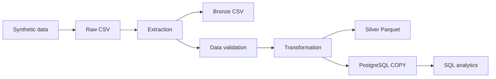

<!-- Profile README: Anuj05Chandrol/Anuj05Chandrol -->

  
  

  
  
  

  
  
  

## 👨‍💻 About Me

I am a **2026 B.Tech Data Science Engineering graduate** from LNCT Group of Colleges, Bhopal, India. I build practical data pipelines, analytical workflows and machine learning applications using Python and SQL.

My current focus is developing reproducible data engineering systems with automated validation, testing and measurable performance. I am expanding into distributed processing, streaming, MLOps and generative AI.

**Open to entry-level opportunities:** Data Engineer · Data Analyst · Python Developer · Software Engineer · Data Science / ML roles across India.

## 🚀 Featured Project — DataFlow Nexus

A modular end-to-end data engineering portfolio project simulating an e-commerce data ecosystem, from synthetic data generation to validated batch ETL, columnar storage and SQL analytics.

### Measured engineering benchmarks

| Metric | Local benchmark |
|---|---:|
| Synthetic records processed | **460,775** |
| Data generation time | 1.58 seconds |
| Batch ETL execution time | 24.642 seconds |
| ETL throughput | 18,699 records/sec |
| Raw CSV size | 16.54 MiB |
| Parquet size | 7.09 MiB |
| Storage reduction | **57.14%** |
| Baseline automated tests | 38 passed |

*Local synthetic-data benchmark recorded November 25, 2026; not a production or distributed workload.*

**Implemented capabilities**
- Reproducible generation of customers, products, orders, order items and payments.
- Schema, primary key, foreign key and financial reconciliation checks.
- Typed Apache Parquet storage with Snappy compression.
- Transactional PostgreSQL bulk ingestion using COPY and full-refresh loading.
- SQL business analytics, Docker infrastructure, unit and integration tests, and GitHub Actions CI.

**Stack:** Python · Pandas · Faker · PyArrow · PostgreSQL · SQLAlchemy · Psycopg · Docker Compose · Pytest · Ruff · GitHub Actions

[Source code and documentation](https://github.com/Anuj05Chandrol/dataflow-nexus) · [Benchmark evidence](https://github.com/Anuj05Chandrol/dataflow-nexus/blob/main/docs/benchmarks/batch_etl_460775.json) · [CI results](https://github.com/Anuj05Chandrol/dataflow-nexus/actions)

**Next milestones:** MinIO, Apache Spark, Kafka, Airflow and dbt.

## 🛠️ Technical Skills

### Hands-on Data Engineering

| Area | Technologies and concepts |
|---|---|
| Data pipelines | Batch ETL, Faker, Pandas, PyArrow, Parquet, Snappy |
| Databases | SQL, PostgreSQL, SQLAlchemy, Psycopg, relational modeling |
| Data reliability | Schema validation, referential integrity, reconciliation |
| Infrastructure | Docker, Docker Compose, Git, GitHub Actions |
| Testing | Pytest, pytest-cov, Ruff, unit and integration testing |

### Additional skills and academic experience

| Area | Technologies and concepts |
|---|---|
| Programming | Python, Java, SQL, JavaScript, HTML, CSS |
| Machine learning | NumPy, Scikit-learn, TensorFlow, XGBoost, SHAP |
| Analytics | Power BI, Excel, Matplotlib, Seaborn |
| Web development | Flask, React, REST APIs |
| Developer tools | VS Code, Jupyter, Google Colab, Git, GitHub |
| CS fundamentals | DSA, OOP, DBMS, debugging and problem solving |

## 📂 Additional Projects

| Project | Description | Technologies | Availability |
|---|---|---|---|
| House Price Prediction | Real estate price prediction with model explainability and a web interface | Python, Flask, XGBoost, SHAP, Pandas | Source publication planned |
| Stock Market Trend Analyzer | Historical market data analysis, LSTM forecasting and visualization | Python, TensorFlow, yFinance, Matplotlib | Source publication planned |

## 📚 Currently Learning

| Specialization | Technologies and concepts |
|---|---|
| Distributed data engineering | Apache Spark, Kafka, Airflow, dbt |
| Data infrastructure | MinIO, Redis, analytical data warehousing |
| Generative AI | Ollama, LangChain, RAG, vector databases |
| MLOps | MLflow, DVC, model monitoring |
| Full-stack development | FastAPI, Next.js, TypeScript |
| Cloud and systems | AWS fundamentals, Linux |

## 🏗️ Engineering Portfolio Roadmap

| Project | Focus | Status |
|---|---|---|
| [**DataFlow Nexus**](https://github.com/Anuj05Chandrol/dataflow-nexus) | End-to-end data engineering | 🟢 Active development |
| RetailIQ | Retail analytics and business intelligence | Planned |
| FraudShield AI | Financial fraud detection | Planned |
| KnowledgeOS | Generative AI and document intelligence | Planned |
| ModelOps | Machine learning lifecycle automation | Planned |
| CareerIntel AI | Job market analytics | Planned |
| Professional portfolio website | Project case studies and demonstrations | Planned |

## 🏆 Certifications

| Certification | Issuer | Year |
|---|---|---:|
| Data Analytics Job Simulation | Deloitte Australia — Forage | 2025 |
| Machine Learning I | Columbia+ | 2025 |
| SQL for Data Analysis | Udemy | 2025 |
| Python Basic Skill Certification | HackerRank | 2025 |
| Python Essentials 1 | Cisco Networking Academy | 2025 |

## 🎓 Education

**Bachelor of Technology — Data Science Engineering (2022–2026)**  
LNCT Group of Colleges, Bhopal  
Rajiv Gandhi Proudyogiki Vishwavidyalaya (RGPV)

## 📈 GitHub Activity

  <picture>
    <source media="(prefers-color-scheme: dark)" srcset="https://raw.githubusercontent.com/Anuj05Chandrol/Anuj05Chandrol/output/github-contribution-grid-snake-dark.svg" />
    <source media="(prefers-color-scheme: light)" srcset="https://raw.githubusercontent.com/Anuj05Chandrol/Anuj05Chandrol/output/github-contribution-grid-snake.svg" />
    
  </picture>

<b>View GitHub statistics and contribution history</b>

 

  
  
  
  

<b>View automated GitHub metrics</b>

 

  

## 🤝 Connect With Me

**Open to entry-level engineering opportunities and technical collaboration.**

*Turning raw data into reliable insights and intelligent solutions.*

